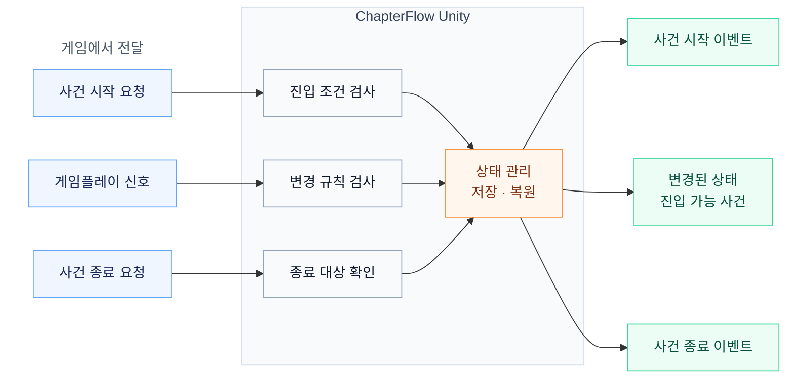

<h1 align="center">ChapterFlow Unity</h1>

<p align="center">
  <strong>생성된 챕터를 실제 게임플레이로</strong><br>
  게임 행동에 따른 심볼 변화와 사건 진행을 관리하는 Unity 런타임
</p>

<p align="center">
  <a href="LICENSE"></a>
  
  
</p>

<p align="center">
  <a href="#빠른-시작">빠른 시작</a> ·
  <a href="#실행-흐름">실행 흐름</a> ·
  <a href="#게임-연결">게임 연결</a> ·
  <a href="https://github.com/Evolutionary-Game-LAB/ChapterFlow-generator">챕터 생성기</a>
</p>

---

**ChapterFlow Unity**는 ChapterFlow JSON을 가져와 게임 행동, 심볼 상태, 사건 시작·종료와 진행 저장을 연결하는 Unity 플러그인. 생성된 실행 규칙을 사용하는 오프라인 런타임으로, 플레이 중 LLM 호출이나 API 키 불필요.

## 주요 기능

| 기능 | 내용 |
| --- | --- |
| **챕터 임포트** | ChapterFlow JSON을 `.chapterflow` 에셋 또는 `TextAsset`으로 로딩 |
| **허용된 상태 변경** | 현재 사건에 선언된 신호 실행 및 심볼별 변화 처리 |
| **명시적 사건 진행** | 게임의 종료 요청과 다음 사건 시작 요청을 독립적으로 처리 |
| **조건 기반 진입** | 현재 상태와 사건 연결에 따른 진입 가능 여부 검사 |
| **진행 저장·복원** | 심볼 상태, 사건 진행 및 부분 실행 이력 저장 |
| **Unity 연동** | `UnityEvent`, 사건 바인딩, 런타임 디버거와 Quick Start 샘플 제공 |

## 실행 흐름

게임이 행동과 진행 시점을 결정하고, 플러그인이 챕터의 실행 규칙을 검사하는 구조.



**조건 충족은 진입 가능 상태를 의미하며, 실제 전환은 게임의 시작 요청으로 수행.** 상태 변경·사건 종료·다음 사건 시작을 분리하여 연출과 플레이 타이밍의 자유 확보.

## 빠른 시작

| 항목 | 기준 |
| --- | --- |
| 패키지 | `com.chapterflow.runtime` · `0.1.1` |
| 최소 Unity 버전 선언 | Unity 2022.3 · C# 9 |
| 실제 Editor 검증 환경 | Unity 6000.6.6f1 |
| 의존성 | `com.unity.nuget.newtonsoft-json` 3.2.2 |

### 1. 패키지 설치

Unity Package Manager의 **Install package from git URL** 또는 **Add package from git URL**에 다음 주소 입력.

```text
https://github.com/Evolutionary-Game-LAB/ChapterFlow-unity.git
```

로컬 설치 경로: 저장소 클론 → **Install package from disk** → 루트의 `package.json` 선택.

### 2. 샘플 실행

1. Package Manager에서 **ChapterFlow Quick Start** 샘플 Import
2. **Tools → ChapterFlow → Create Quick Start Scene** 선택
3. 생성된 씬에서 Play 실행 및 게임플레이 신호·사건 전환 확인

### 3. 생성한 챕터 연결

1. ChapterFlow 웹툴 또는 [Generator](https://github.com/Evolutionary-Game-LAB/ChapterFlow-generator)에서 JSON 준비
2. **Tools → ChapterFlow → Import Web JSON...** 메뉴로 임포트
3. 생성된 `.chapterflow` 에셋을 `ChapterRunner`의 **Chapter** 필드에 지정
4. 사건 시작·종료와 게임플레이 신호를 버튼·상호작용·연출에 연결

`.json` 파일을 `TextAsset`으로 가져와 **Chapter Json** 필드에 직접 지정하는 방식도 지원. **Tools → ChapterFlow → Runtime Debugger**에서 실행 상태 확인 가능.

## 게임 연결

Quick Start의 [신호 실험실](Samples~/QuickStart/signal-lab.json) 기준 예시. `runner`는 챕터 에셋이 지정된 `ChapterFlow.Unity.ChapterRunner` 참조.

```csharp
// 챕터 초기화와 첫 사건 시작
if (!runner.InitializeChapter()) return;
runner.StartFirstEvent();

// 출입증 획득 행동에 연결할 심볼 변화
string badgeKey = ChapterFlow.ChapterDefinition.SymbolKey("badge");
if (!runner.TrySendSymbolGameplay("find_badge", badgeKey)) return;

// 사건 마무리와 다음 사건 시작: 게임의 각 타이밍에 연결할 별도 명령
if (!runner.TryEndEvent(runner.Session.ActiveEventId)) return;
runner.TryStartEvent("start:control");
```

위 코드는 샘플 호출 순서이며, 실제 게임에서는 각 명령을 해당 상호작용 시점에 배치. 다른 챕터에서는 해당 JSON의 신호 ID·심볼 키·시작 트리거 사용.

| API | 역할 |
| --- | --- |
| `TrySendSymbolGameplay(signalId, symbolKey)` | 신호에 선언된 특정 심볼의 효과만 실행 |
| `TrySendGameplay(signalId)` | 신호에 남아 있는 효과 전체 실행 |
| `EndCurrentEvent()` / `TryEndEvent(eventId)` | 현재 사건의 명시적 종료 |
| `StartEvent(trigger)` / `TryStartEvent(trigger)` | 조건 검사 후 지정 사건 시작 |
| `Session.GetAvailableEvents()` | 현재 상태 기준 진입 가능한 사건 조회 |
| `CaptureSaveJson()` / `RestoreSaveJson(json)` | 진행 상태의 JSON 저장·복원 |

성공 여부 확인에는 `Try...` 메서드, Inspector의 버튼·UnityEvent 연결에는 `SendGameplay`, `EndCurrentEvent`, `StartEvent` 등의 `void` 메서드 사용.

**연출·UI 연결 이벤트:** `OnEventStarted`, `OnEventEnded`, `OnGameplayReceived`, `OnStateChanged`, `OnEndingReached`, `OnSessionRestored`, `OnError`. 특정 사건의 시작·종료 바인딩에는 `ChapterEventBinding` 활용.

## 실행 규칙과 저장

- 실행 기준은 JSON의 `gameplay` (`chapter-gameplay-v1`). 서사 문장으로부터 새로운 상태 변화를 추측하지 않는 방식
- 허용 신호·사전 조건·되돌림 불가 규칙을 검사한 뒤 상태 변경
- 여러 효과 중 일부 실행 후 나머지 효과의 후속 실행 지원 및 일회성 숫자 효과 중복 적용 방지
- 웹 플레이 테스트의 편의상 자동 종료·시작과 달리, Unity에서는 두 요청의 독립 제어

진행 저장 형식은 `chapterflow-unity-save-v1`. `0.1.1`에서 심볼별 부분 실행 기록인 `partialResults` 추가 및 이전 저장 읽기 지원. 부분 실행이 포함된 새 저장을 `0.1.0`으로 불러오는 방식은 미지원.

챕터 fingerprint 불일치 시 복원 거부. 게임 월드 오브젝트와 연출 상태는 `OnSessionRestored`에서 별도 동기화 필요.

## 검증

2026-11-03 공개 준비 시 수행한 검증 기록:

| 범위 | 결과 |
| --- | --- |
| 저장된 챕터의 웹·C# 실행 비교 | 24개 시나리오 · 446개 명령 통과 |
| 매 단계 저장·복원 | 446회 통과 |
| 기존 코어 계약 검사 | 53개 통과 |
| Unity Editor 임포트·Play | Unity 6000.6.6f1에서 챕터 4개 · Runner 14개 명령 검증 |

공개 합성 테스트 실행 방법:

```sh
dotnet run --project Verification~/Parity.csproj -- Verification~/fixtures/parity-cases.json Samples~/QuickStart/signal-lab.json
```

검증 도구에만 .NET 10 SDK 필요. 위 결과는 저장된 챕터·합성 사례 기준이며, 새로운 LLM 생성 품질 검증은 제외. Unity Player 빌드·IL2CPP·다른 Unity 버전은 미검증.

## 문서와 관련 프로젝트

- [실행 규칙](CONTRACT.md) · [JSON Schema](schemas/chapter-gameplay-v1.schema.json) · [검증 상세](VALIDATION.md) · [변경 기록](CHANGELOG.md)
- [ChapterFlow Generator](https://github.com/Evolutionary-Game-LAB/ChapterFlow-generator) — 서사 개요를 분기 챕터로 변환하는 생성기
- [Issues](https://github.com/Evolutionary-Game-LAB/ChapterFlow-unity/issues) — Unity 버전·재현 절차·최소 샘플을 포함한 오류 제보

## 라이선스

[Apache License 2.0](LICENSE) 적용. 외부 의존성의 개별 라이선스 및 목록은 [THIRD-PARTY.md](THIRD-PARTY.md) 참조.
